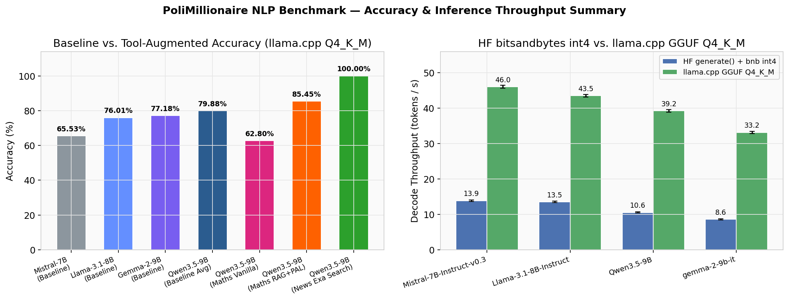
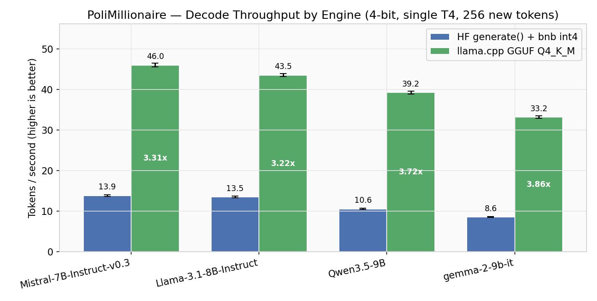

# PoliMillionaire NLP Benchmark

A multimodal, tool-augmented benchmark for playing a *Who Wants To Be a Millionaire*-style trivia game with open-weight language models.

The project evaluates model accuracy, inference speed, retrieval, mathematical reasoning, live web search, and speech recognition under a strict per-question time limit.

## Project Highlights

- Benchmarks four 7B-9B open-weight models:
  - Qwen3.5-9B
  - Llama 3.1 8B Instruct
  - Gemma 2 9B IT
  - Mistral 7B Instruct v0.3
- Compares Hugging Face + bitsandbytes 4-bit inference with llama.cpp + GGUF Q4_K_M.
- Uses CUDA and NVIDIA T4 GPUs for the main experiments.
- Adds specialized pipelines for:
  - Mathematical reasoning with PAL, SymPy, and RAG
  - Wikipedia BM25 retrieval
  - Live search with Exa and Firecrawl
  - Automatic speech recognition with Whisper-small
  - Confidence estimation experiments
- Records per-question answers, correctness, latency, retrieved context, generated code, and tool usage.

## Main Results



All execution outputs are preserved in [`NLP_final.ipynb`](NLP_final.ipynb) and backed by the exported CSV artifacts in [`results/`](results/):

- [`results/baseline_accuracy_llamacpp.csv`](results/baseline_accuracy_llamacpp.csv) — Consolidated 6-topic and overall baseline accuracy under `llama.cpp` (`Q4_K_M`).
- [`results/benchmark_results_raw_llamacpp.csv`](results/benchmark_results_raw_llamacpp.csv) — Raw 4-model `llama.cpp` run table (showing Gemma-2-9B, Llama-3.1-8B, Mistral-7B-v0.3, and the pre-fix 5-token Qwen3.5 run prior to the `<think>` / CoT fix documented in Section 5).
- [`results/maths_rag_pal_results.csv`](results/maths_rag_pal_results.csv) — Executed **RAG (NuminaMath-CoT TF-IDF) + PAL** Maths benchmark run (**85.45%** accuracy, `$1,098,400` total earnings, `8.052s` avg time/question).
- [`results/news_question_logs_exa_15of15.csv`](results/news_question_logs_exa_15of15.csv) & [`results/news_question_logs_5games.csv`](results/news_question_logs_5games.csv) — Full per-question logs (questions, options, retrieved search snippets, raw LLM JSON outputs, correctness, and latency) for the live News search runs (**15/15 = 100.00%** on Exa at `2.57s`/question, and 56 logged questions across 5 multi-source games).
- [`results/category_pipelines_summary.csv`](results/category_pipelines_summary.csv) — Summary comparison across baseline and category-specific tool-augmented pipelines.
- [`results/throughput_comparison.csv`](results/throughput_comparison.csv) ([`throughput_results.csv`](results/throughput_results.csv), [`throughput_results_llamacpp.csv`](results/throughput_results_llamacpp.csv)) — Decoding throughput benchmarks for Hugging Face (`bitsandbytes` 4-bit) vs. `llama.cpp` (`GGUF Q4_K_M`).

The notebook reports both baseline model scores and scores from specialized pipelines built for individual categories. These should not be conflated: the table below is the baseline `llama.cpp` `Q4_K_M` 6-topic comparison ([`results/baseline_accuracy_llamacpp.csv`](results/baseline_accuracy_llamacpp.csv)), while the category results farther below measure the additional PAL, RAG, and live-search systems.

| Model | 6-Topic Average Accuracy |
|---|---:|
| Qwen3.5-9B | **79.88%** |
| Gemma-2-9B | 77.18% |
| Llama-3.1-8B | 76.01% |
| Mistral-7B-v0.3 | 65.53% |

The baseline accuracy varies substantially by topic. The strongest documented baseline topic scores include:

- Gemma-2-9B on Philosophy and Psychology: **97.03%**
- Gemma-2-9B on Science and Nature: **92.93%**
- Qwen3.5-9B on Science and Nature: **90.30%**
- Qwen3.5-9B on Philosophy and Psychology: **93.20%**

### Category-specific pipelines

| Category | Pipeline / model | Reported result | Backing artifact |
|---|---|---:|---|
| Maths | Vanilla Qwen3.5-9B | **62.80%** (~61–63%) | [`results/baseline_accuracy_llamacpp.csv`](results/baseline_accuracy_llamacpp.csv) |
| Maths | Qwen3.5-9B + PAL | **65–66%** | [`NLP_final.ipynb` (§9.1)](NLP_final.ipynb) |
| Maths | Qwen3.5-9B + RAG + PAL | **85.45%** (84–85%) | [`results/maths_rag_pal_results.csv`](results/maths_rag_pal_results.csv) |
| News | Qwen3.5-9B + Exa (1-game run) | **15/15 (100.00%)** | [`results/news_question_logs_exa_15of15.csv`](results/news_question_logs_exa_15of15.csv) |
| News | Qwen3.5-9B + Exa (5-game, 45-question run) | **42/45 (93.33%)** | [`results/news_question_logs_5games.csv`](results/news_question_logs_5games.csv) |
| General topics | Qwen3.5-9B + live search | frequently **15/15 (100%)** | [`NLP_final.ipynb` (§13)](NLP_final.ipynb) |

## Throughput Results



Measured decoding throughput under the documented 4-bit setup ([`results/throughput_comparison.csv`](results/throughput_comparison.csv)):

| Model | Hugging Face | llama.cpp | Speedup |
|---|---:|---:|---:|
| Mistral-7B-v0.3 | 13.88 tok/s | **46.01 tok/s** | 3.31x |
| Llama-3.1-8B | 13.51 tok/s | 43.52 tok/s | 3.22x |
| Qwen3.5-9B | 10.55 tok/s | 39.23 tok/s | 3.72x |
| Gemma-2-9B | 8.59 tok/s | 33.16 tok/s | 3.86x |

The practical recommendation from the benchmark is:

- **Qwen3.5-9B** for the best balance of accuracy and reasoning robustness.
- **Mistral-7B-Instruct-v0.3** for maximum decoding throughput.
- **llama.cpp + GGUF Q4_K_M** for fast single-stream deployment on a T4.

## Notebook Structure

The main notebook is [`NLP_final.ipynb`](NLP_final.ipynb).

| Section | Purpose |
|---|---|
| 1 | Environment setup, authentication, and game client installation |
| 2 | Benchmark methodology |
| 3 | Quantization background |
| 4 | Shared configuration and helper functions |
| 5 | llama.cpp accuracy benchmark |
| 6 | Hugging Face versus llama.cpp throughput |
| 7 | Results loading, summaries, and charts |
| 8 | vLLM discussion and exclusion rationale |
| 9 | Mathematical tools, PAL, and RAG + PAL |
| 10 | Qwen3-8B LoRA fine-tuning experiment |
| 11-13 | Wikipedia, Exa, Firecrawl, and general-topic search |
| 14 | Whisper-small speech-mode benchmark |
| 15 | Confidence estimation discussion |
| 16-17 | Literature review, next steps, and AI-assisted development |

## Requirements

The original notebook was designed primarily for Kaggle GPU environments with CUDA. A complete run requires:

- Python 3.10+
- NVIDIA GPU with sufficient VRAM, preferably a T4 or better
- CUDA-compatible PyTorch
- Hugging Face access, including a token for gated models such as Llama 3.1
- Credentials for the PoliMillionaire game server
- Optional API keys for Exa and Firecrawl
- Optional Kaggle Secrets for credentials and API keys

Core Python packages include:

```text
accelerate
bitsandbytes
datasets
huggingface_hub
llama-cpp-python
matplotlib
numpy
pandas
rank_bm25
requests
scikit-learn
soundfile
sympy
torch
transformers
```

The notebook installs several dependencies in its setup cells. For the best compatibility, run it in the intended CUDA/Kaggle environment rather than a CPU-only local environment.

## Running the Notebook

The notebook is an ensemble of experiments collected from multiple runs. It can be executed standalone, but running every benchmark end to end is time-consuming and requires external services.

Recommended order:

1. Run **Section 1** to install dependencies and configure authentication.
2. Run **Section 4** to load the shared configuration and helpers.
3. Run **Section 5** for the llama.cpp accuracy pipeline.
4. Run **Section 6** for throughput measurements.
5. Run **Section 7** to load existing CSV results and generate comparisons.
6. Run Sections 9-14 only when the corresponding model, data, API keys, and services are available.

Expected output files include:

- `accuracy_per_question.csv`
- `accuracy_per_question_llamacpp.csv`
- `throughput_results.csv`
- `throughput_results_llamacpp.csv`
- `throughput_comparison.csv`
- `throughput_comparison.png`
- `question_logs_*.csv`
- `asr_speech_results.csv`

## Methodology Notes

The main accuracy pipeline combines:

1. Next-token logits scoring for option IDs `0` through `3`.
2. Short chain-of-thought generation when the logits confidence gap is low.
3. Strict answer parsing and per-question telemetry.

The throughput benchmark uses a fixed prompt, deterministic decoding, one warm-up run, and three timed runs. Both engines generate the same target number of new tokens.

The notebook also tests external tools where model-only reasoning is less reliable. Mathematical questions use generated Python, SymPy, retrieval from NuminaMath-CoT, and option matching. News and general-knowledge questions can use live search or Wikipedia-based BM25 retrieval. Speech mode uses Whisper-small to transcribe the question and answer options in memory.

## Limitations

- Results come from multiple runs and are not all directly comparable.
- Some sections depend on a live game server, external APIs, gated model access, and Kaggle Secrets.
- The complete notebook is not a lightweight local demo; several cells download multi-gigabyte models and run long benchmarks.
- The reported accuracy table is the authoritative documented aggregate for the main llama.cpp comparison. Exact scores for individual live-search experiments should be read from their generated logs.

## Authors

- Gabriele Bandino
- Matteo Parimbelli
- Francescomaria Reggio
